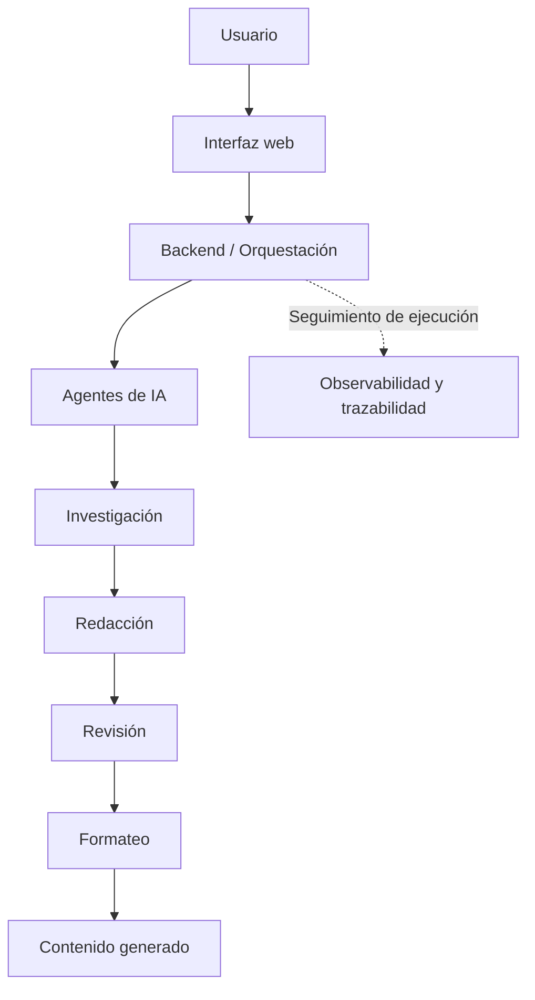

# AlejandrIA

**Plataforma de generación de contenido científico asistida por inteligencia artificial**


> Proyecto Capstone de Ingeniería en Informática de **Duoc UC**, desarrollado en colaboración con la **Cámara Chilena de la Construcción (CChC)**.

## 📖 Descripción

**AlejandrIA** es una plataforma orientada a la creación de artículos y revistas científicas mediante inteligencia artificial generativa. Su funcionamiento se basa en la colaboración de distintos agentes especializados y en el uso de modelos de lenguaje que apoyan etapas como la investigación, redacción, revisión y formateo del contenido.

La solución **ya cuenta con una base desarrollada** y se encuentra en una etapa inicial de validación tecnológica, identificada en el proyecto como **TRL 3**. Por ello, nuestro trabajo no consiste en construirla desde cero, sino en **evaluar, estabilizar y ampliar sus capacidades**.

Este repositorio reúne el trabajo realizado durante el Capstone 2026, incluyendo pruebas, análisis de resultados, corrección de errores y desarrollo de nuevas funcionalidades.

## 🎯 Objetivo

Contribuir a la evolución de AlejandrIA mediante la evaluación de su funcionamiento, la identificación y corrección de problemas técnicos y la incorporación de mejoras que permitan generar contenido científico con mayor **estabilidad, trazabilidad y transparencia**.

### Objetivos específicos

- Evaluar el funcionamiento de los módulos y agentes existentes.
- Ejecutar pruebas con distintos modelos de inteligencia artificial y revisar la calidad de los resultados.
- Registrar hallazgos, errores y diferencias entre el comportamiento esperado y el observado.
- Corregir y optimizar componentes del frontend y backend según las prioridades del proyecto.
- Incorporar mecanismos de **observabilidad** para visualizar la ejecución de los agentes.
- Mejorar la **trazabilidad** de la generación de artículos, desde la solicitud hasta el resultado final.

## ⚙️ ¿Cómo funciona?

De manera general, la plataforma recibe una solicitud de generación de contenido y coordina agentes de IA encargados de distintas actividades. Estos agentes producen y procesan información hasta obtener un documento final.



> **Nota:** este diagrama es una representación conceptual del flujo. La arquitectura y las conexiones específicas se documentarán a medida que se complete la revisión técnica.

## 🧩 Líneas de trabajo

| Área | Trabajo contemplado |
| --- | --- |
| Diagnóstico | Identificación de errores, limitaciones y oportunidades de mejora. |
| Pruebas | Validación de flujos, agentes, modelos y resultados generados. |
| Calidad del contenido | Comparación entre las funciones definidas y el resultado real de la plataforma. |
| Mantenimiento | Corrección de errores y mejoras en frontend y backend. |
| Observabilidad | Visualización de ejecuciones, estados, tiempos y eventos relevantes. |
| Trazabilidad | Seguimiento de las etapas, agentes y modelos involucrados en cada generación. |

## 🛠️ Tecnologías y componentes

- **Frontend:** aplicación web ejecutada en el entorno de desarrollo con **Vite**.
- **Backend:** servicios y lógica de coordinación de los procesos de generación.
- **Inteligencia artificial:** modelos de lenguaje (LLM) y agentes especializados.
- **Modelos evaluados:** entre las pruebas realizadas se ha utilizado **Llama 3.2 3B**.

> El inventario completo de dependencias, frameworks, base de datos y servicios externos está sujeto a la revisión del código y de la configuración del proyecto. Se actualizará conforme se verifique cada componente.

## 🚀 Ejecución local

### Requisitos

- Node.js y npm instalados.
- Código fuente del proyecto disponible localmente.
- Configuración del backend y de los servicios/modelos de IA que utilice la plataforma.

### Iniciar el frontend

Desde la raíz del repositorio:

```bash
cd frontend
npm install
npm run dev
```

Una vez iniciado Vite, abrir la dirección local indicada en la terminal (habitualmente `http://localhost:5173/`).

### Iniciar el backend

El procedimiento de inicio del backend y sus variables de entorno depende de la configuración actual del proyecto. **Esta sección está pendiente de documentación técnica**; no se incluyen comandos sin haberlos verificado.

> **Importante:** evita publicar credenciales, claves de API y archivos `.env` en el repositorio.

## 📍 Estado y próximas etapas

**Estado actual: en desarrollo y evaluación.**

El trabajo contempla las siguientes etapas, que pueden solaparse según los hallazgos:

1. **Revisión de la plataforma existente:** comprensión de sus módulos y del flujo de agentes.
2. **Pruebas y documentación:** registro de errores, resultados y diferencias respecto del comportamiento esperado.
3. **Correcciones y optimización:** solución de problemas priorizados.
4. **Nuevas funcionalidades:** implementación de mejoras, especialmente en observabilidad y trazabilidad.
5. **Validación:** comprobación de los cambios realizados y documentación de resultados.

## 👥 Equipo

**Proyecto Capstone 2026 — Ingeniería en Informática, Duoc UC**

- Nicolás
- Francisco

**Entidad colaboradora:** Cámara Chilena de la Construcción (CChC).

## 📝 Consideraciones

Este repositorio corresponde a un proyecto académico realizado sobre una plataforma preexistente. Las funcionalidades descritas como objetivos o líneas de trabajo **no deben interpretarse como implementaciones ya finalizadas**.

La licencia de distribución y las condiciones de uso del código deben confirmarse con los responsables del proyecto antes de publicar o reutilizar sus componentes.
